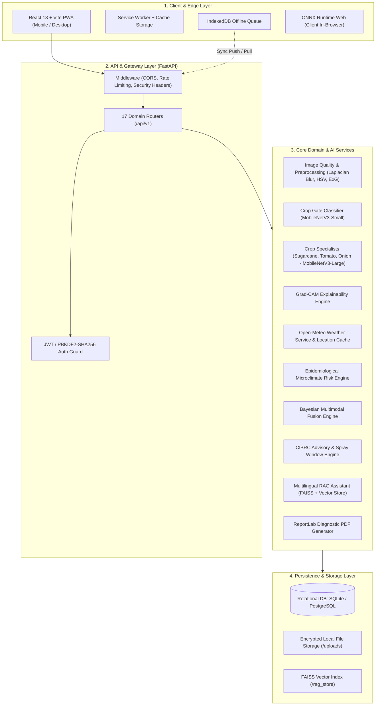
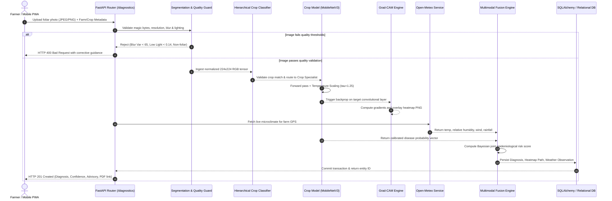

# PikVaidya AI — Complete Backend Architecture Specification

**Document Version:** 2.0  
**Status:** Production Standard  
**Architecture Paradigm:** Layered Asynchronous Micro-Monolith (FastAPI + PyTorch + SQLAlchemy + SQLite/PostgreSQL)  
**Primary Target Regions:** Maharashtra, India (Western Agro-Climatic Zone)  

---

## 1. System Overview & Architectural Paradigm

PikVaidya AI is engineered as a high-performance, asynchronous, production-grade agricultural AI platform. The system operates on an offline-first, mobile-responsive PWA frontend coupled with a resilient FastAPI backend. It fulfills four primary missions:
1. **Foliar Pathology Diagnosis:** Low-latency deep learning image classification across cash and vegetable crops (Sugarcane, Tomato, Onion).
2. **Microclimate Epidemiology Fusion:** Integration of live meteorological telemetry to calculate disease conduciveness risk tiers.
3. **Multilingual Advisory & Decision Support:** Dynamic generation of CIBRC-compliant spray schedules, irrigation recommendations, and biosecurity protocols in Marathi, Hindi, and English.
4. **Offline Edge Resilience:** On-device ONNX runtime inference with background queue synchronization to ensure uninterrupted operation in rural dead-zones.



---

## 2. Directory Structure

```text
backend/
├── app/
│   ├── api/
│   │   ├── routes/
│   │   │   ├── __init__.py           # Mounts all 17 routers & health endpoint
│   │   │   ├── admin.py              # Telemetry, process memory, audit logs
│   │   │   ├── advisory.py           # Field advisories & spray window evaluation
│   │   │   ├── assistant.py          # Multilingual RAG assistant chat
│   │   │   ├── auth.py               # Registration, JWT token issue, refresh
│   │   │   ├── crop_health.py        # Unified multi-crop health analysis
│   │   │   ├── crops.py              # Crop cycle stages and growth tracking
│   │   │   ├── diagnostics.py        # Diagnostic image upload, history, PDF
│   │   │   ├── diseases.py           # Master agricultural disease catalog
│   │   │   ├── experts.py            # Agronomist review request & triage
│   │   │   ├── farmer.py             # Farmer profile & language preference
│   │   │   ├── farms.py              # Farm cadastral plots, soil, GPS coordinates
│   │   │   ├── models.py             # Active model inventory & specs
│   │   │   ├── multimodal.py         # Image + Weather Bayesian fusion
│   │   │   ├── notifications.py      # Push & in-app alerts
│   │   │   ├── risk.py               # Environmental disease conduciveness
│   │   │   ├── sync.py               # Edge IndexedDB push/pull synchronization
│   │   │   └── weather.py            # Meteorological forecasts & historical data
│   │   └── __init__.py
│   ├── core/
│   │   ├── config.py                 # Pydantic BaseSettings, env variables
│   │   ├── logging.py                # Structured JSON logging
│   │   └── security.py               # Cryptographic hashing & JWT handlers
│   ├── db/
│   │   ├── base.py                   # Declarative base registry
│   │   ├── init_db.py                # Database seeder & catalog bootstrap
│   │   └── session.py                # Thread-safe SQLAlchemy sessionmaker
│   ├── dependencies.py               # Shared FastAPI dependency injections
│   ├── main.py                       # FastAPI ASGI application root & lifespan
│   ├── models/                       # SQLAlchemy ORM entity definitions
│   │   ├── audit_log.py              # Enterprise audit trails
│   │   ├── crop_cycle.py             # Crop lifecycle stage tracking
│   │   ├── diagnosis.py              # Diagnostic inferences and heatmap links
│   │   ├── disease.py                # Master disease reference entities
│   │   ├── expert_review.py          # Agronomist verification logs
│   │   ├── farm.py                   # Geographic farm parcels
│   │   ├── notification.py           # In-app notifications
│   │   ├── user.py                   # User identity and credentials
│   │   └── weather.py                # Historical weather observations
│   ├── schemas/                      # Pydantic v2 validation contracts
│   └── services/                     # Business domain & AI inference engines
│       ├── ai_service.py             # Model loading, gating & inference
│       ├── diagnostic_service.py     # End-to-end diagnostic pipeline
│       ├── recommendation_engine.py  # Advisory synthesis & CIBRC safety
│       ├── report_service.py         # ReportLab PDF compilation
│       ├── segmentation_service.py   # Blur, lighting, and plant mask safeguards
│       ├── weather/                  # Weather client & epidemiology engineer
│       └── rag/                      # Document chunking, FAISS, assistant
├── models/                           # PyTorch .pth checkpoints & INT8 ONNX
└── tests/                            # 32 comprehensive pytest suites
```

---

## 3. Technology Stack

| Layer | Framework / Library | Selected Version | Strategic Technical Rationale |
| :--- | :--- | :--- | :--- |
| **API Runtime** | FastAPI (Starlette + Pydantic v2) | 0.115+ | Native async I/O, automatic OpenAPI schema generation, compile-time schema validation. |
| **ASGI Server** | Uvicorn / Gunicorn | 0.30+ | Ultra-fast HTTP/1.1 and WebSocket processing via `uvloop` and `httptools`. |
| **Deep Learning** | PyTorch & Torchvision | 2.5+ | Dynamic computation graphs, GPU/CPU portability, native support for Grad-CAM autograd hooks. |
| **Edge Inference** | ONNX Runtime | 1.20+ | INT8-quantized execution offering 4x latency reduction and 75% memory footprint compression. |
| **Computer Vision** | Pillow + NumPy + OpenCV | 11.0+ / 2.1+ | Hardware-accelerated matrix operations for discrete Laplacian variance and HSV foliage extraction. |
| **Relational ORM** | SQLAlchemy 2.0 | 2.0+ | Unified async/sync dialect abstraction supporting seamless switching between SQLite and PostgreSQL. |
| **RAG & Search** | FAISS + Sentence-Transformers | 1.9+ | Sub-millisecond dense vector similarity retrieval over agricultural pathology publications. |
| **PDF Engine** | ReportLab | 4.2+ | Low-level Canvas and Flowable document construction for production-grade diagnostic certificates. |

---

## 4. End-to-End Data Flow Architecture

The diagnostic lifecycle executes through 8 strictly sequential stages:



---

## 5. Detailed Component Specifications

### 5.1 Image Quality & Responsible AI Safeguards (`segmentation_service.py`)
To prevent "garbage-in, garbage-out" diagnostic failures in rural lighting conditions, incoming images undergo three mathematical quality checks prior to neural inference:
1. **Discrete 2D Laplacian Variance (Blur Detection):**
   $$\sigma^2 = \text{Var}\left( \nabla^2 I \right)$$
   Images with $\sigma^2 < 65.0$ are classified as motion-blurred or out-of-focus and rejected.
2. **Normalized Luminance Distribution (Exposure Check):**
   Mean pixel intensity $\mu_L$ across grayscale space:
   - Underexposed: $\mu_L < 0.14$ (insufficient lighting for foliar lesion differentiation).
   - Overexposed: $\mu_L > 0.89$ (sun glare causing severe feature washout).
3. **Foliage Plant-Matter Masking (Out-of-Distribution Rejection):**
   Excess Green Index ($\text{ExG} = 2G - R - B$) and HSV color gating ensure the image contains at least $8.0\%$ authentic plant matter, rejecting animal, face, or inanimate object uploads.

### 5.2 Unified AI Inference Pipeline (`diagnostic_service.py`, `ai_service.py`)
- **Stage 1 (Crop Gate):** `MobileNetV3-Small` checks whether the uploaded foliage belongs to Sugarcane, Tomato, or Onion. If an image declared as Sugarcane is identified as Tomato with $>90\%$ confidence, a crop mismatch warning is raised.
- **Stage 2 (Specialist Pathology Classification):** Dedicated `MobileNetV3-Large` models evaluate crop-specific pathologies.
- **Stage 3 (Platt Softmax Temperature Scaling):**
  $$P(y = i | z) = \frac{\exp(z_i / \tau)}{\sum_j \exp(z_j / \tau)}$$
  With calibrated $\tau = 1.25$, extreme raw logits are damped, producing realistic, well-calibrated probabilities.

### 5.3 Explainable AI (Grad-CAM Engine)
Grad-CAM calculates the gradient of the winning class score $y^c$ with respect to feature activation map $A^k$ of the final convolutional layer (`features[16]`):
$$\alpha_k^c = \frac{1}{Z} \sum_i \sum_j \frac{\partial y^c}{\partial A_{i,j}^k}$$
$$L_{\text{Grad-CAM}}^c = \text{ReLU}\left( \sum_k \alpha_k^c A^k \right)$$
The resulting heatmap is normalized $[0, 1]$, color-mapped to Jet palette, alpha-blended ($0.4$ opacity) over the original image, and stored as an evidence artifact.

### 5.4 Multimodal Bayesian Risk Engine (`multimodal.py`, `risk.py`)
The platform fuses computer vision outputs with environmental conduciveness vectors:
- **Temperature & Humidity Conduciveness:** Fungal pathogens (e.g., Sugarcane Red Rot, Tomato Late Blight, Onion Purple Blotch) proliferate rapidly under prolonged canopy wetness ($\text{RH} > 80\%$) and moderate temperatures ($20^\circ\text{C} - 30^\circ\text{C}$).
- **Joint Risk Formulation:** The system computes an overall risk tier:
  - `CRITICAL`: High foliar confidence ($> 85\%$) AND High environmental conduciveness ($> 75\%$).
  - `ELEVATED`: Foliar lesion confirmed, but microclimate conditions temporarily inhibit spore propagation.
  - `PREVENTIVE_WARNING`: Healthy foliage, but severe environmental conduciveness creates imminent outbreak risk.

### 5.5 Agricultural Advisory & CIBRC Compliance Engine (`recommendation_engine.py`)
Advisories are generated using a deterministic rule engine verified against Central Insecticides Board & Registration Committee (CIBRC) guidelines:
- Chemical treatments specify active chemical ingredient, recommended dosage per liter/acre, and pre-harvest interval (PHI).
- Bio-control alternatives (e.g., *Trichoderma viride*, *Pseudomonas fluorescens*, Neem oil) are prioritized for organic certified plots.
- Spray window intelligence assesses wind speed ($< 15\text{ km/h}$) and rain probability ($< 30\%$) to prevent chemical drift and wash-off.

### 5.6 Multilingual RAG Knowledge Assistant (`rag/assistant.py`)
- Ingests university extension manuals (e.g., MPKV Rahuri, ICAR-IISR Lucknow).
- Chunks text into 500-token windows with 50-token overlaps, vectorized using `sentence-transformers/paraphrase-multilingual-MiniLM-L12-v2`.
- Queries trigger similarity searches in FAISS.
- Context injection formats prompt templates with strict anti-hallucination constraints: all non-verified agrochemicals are purged from outputs.

---

## 6. Security, Identity & Compliance

1. **Password Storage:** Salted PBKDF2 with SHA-256 (310,000 iterations).
2. **Session Security:** Short-lived JWT bearer tokens with cryptographic secret signing (`HS256`).
3. **Role-Based Access Control (RBAC):** Three discrete security scopes:
   - `farmer`: Access restricted to self-owned farms, crops, and diagnostic records.
   - `expert`: Access to triage review queue, pending diagnoses, and clinical override forms.
   - `admin`: Access to system telemetry, process memory, user directories, and audit trails.
4. **Input Defense:** File uploads require magic-byte inspection (preventing `.php`/`.exe` masquerading as `.jpg`), size capping (10 MB), and strict path sanitization.

---

## 7. Database Entity Relationship Overview

The platform uses 10 core tables:
- `users`: Credentials, full names, phone numbers, preferred languages (`mr`, `hi`, `en`), roles.
- `farms`: Geographic boundaries, acreage, soil types, irrigation methods, owner IDs.
- `crop_cycles`: Active crop varieties, planting dates, growth stages.
- `diagnoses`: Processed image hashes, class labels, calibrated confidences, heatmap URIs, weather context.
- `disease_knowledge`: Multilingual disease descriptions, symptom guides, and management protocols.
- `weather_observations`: Hourly snapshots of temperature, humidity, wind, and precipitation.
- `notifications`: User-bound operational, weather, and expert alerts.
- `expert_reviews`: Farmer review requests, agronomist notes, diagnosis confirmations/overrides.
- `audit_logs`: Immutable security and data synchronization audit trails.
- `alembic_version`: Database migration tracking.
