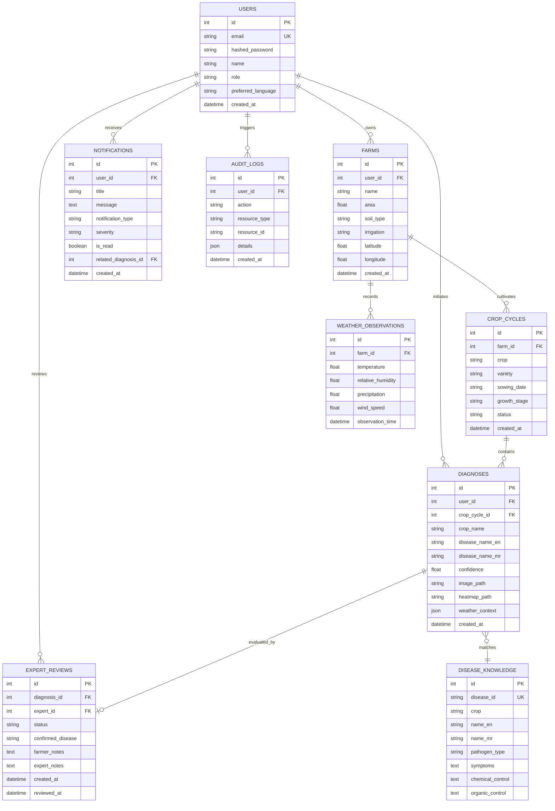

# PikVaidya AI — Complete Database Architecture & Audit

**Document Version:** 2.0  
**Audit Date:** November 13, 2026  
**Auditor:** Database Architect & Technical Auditor  
**Engines Supported:** SQLite 3.40+ (Development / Edge), PostgreSQL 15+ (Production)  
**ORM Framework:** SQLAlchemy 2.0 (Declarative Base with strict typing)  
**Total Tables Audited:** 10 Core Tables  

---

## 1. Relational Entity Relationship Diagram

---

## 2. Table-by-Table Schema Specification

### 2.1 `users` Table
Stores authentication credentials, user contact information, and role authorization.
- `id` (INTEGER, Primary Key, Auto-increment)
- `email` (VARCHAR(255), Unique, Indexed, NOT NULL)
- `hashed_password` (VARCHAR(255), NOT NULL) — Salted PBKDF2-SHA256 hash.
- `name` (VARCHAR(150), NOT NULL) — Full farmer / expert name.
- `phone_number` (VARCHAR(30), Nullable)
- `role` (VARCHAR(30), NOT NULL, Default: `'farmer'`) — Scopes: `farmer`, `expert`, `admin`.
- `preferred_language` (VARCHAR(10), NOT NULL, Default: `'mr'`) — Language code: `mr` (Marathi), `hi` (Hindi), `en` (English).
- `is_active` (BOOLEAN, NOT NULL, Default: `True`)
- `created_at` (TIMESTAMP WITH TIMEZONE, Default: `now()`)

### 2.2 `farms` Table
Stores cadastral farm plots and geospatial coordinates.
- `id` (INTEGER, Primary Key, Auto-increment)
- `user_id` (INTEGER, Foreign Key -> `users.id`, Indexed, NOT NULL, OnDelete: CASCADE)
- `name` (VARCHAR(150), NOT NULL)
- `area` (FLOAT, NOT NULL) — Total area in Acres.
- `soil_type` (VARCHAR(100), Nullable) — E.g., Black Clay, Alluvial, Laterite.
- `irrigation` (VARCHAR(100), Nullable) — E.g., Drip, Furrow, Sprinkler.
- `latitude` (FLOAT, NOT NULL) — WGS84 GPS Latitude.
- `longitude` (FLOAT, NOT NULL) — WGS84 GPS Longitude.
- `district` (VARCHAR(100), Nullable, Indexed)
- `created_at` (TIMESTAMP WITH TIMEZONE, Default: `now()`)

### 2.3 `crop_cycles` Table
Represents a biological cultivation cycle on a specific farm parcel.
- `id` (INTEGER, Primary Key, Auto-increment)
- `farm_id` (INTEGER, Foreign Key -> `farms.id`, Indexed, NOT NULL, OnDelete: CASCADE)
- `crop` (VARCHAR(50), NOT NULL, Indexed) — `sugarcane`, `tomato`, `onion`.
- `variety` (VARCHAR(100), Nullable) — E.g., `Co 86032 (Nira)`, `Abhinav`.
- `sowing_date` (VARCHAR(30), NOT NULL) — ISO 8601 Date string.
- `growth_stage` (VARCHAR(50), NOT NULL) — `germination`, `tillering`, `grand_growth`, `maturity`.
- `status` (VARCHAR(30), NOT NULL, Default: `'active'`)
- `created_at` (TIMESTAMP WITH TIMEZONE, Default: `now()`)

### 2.4 `diagnoses` Table
Stores AI foliar inference outputs, explainability heatmaps, and microclimate context.
- `id` (INTEGER, Primary Key, Auto-increment)
- `user_id` (INTEGER, Foreign Key -> `users.id`, Indexed, NOT NULL)
- `crop_cycle_id` (INTEGER, Foreign Key -> `crop_cycles.id`, Nullable, Indexed)
- `crop_name` (VARCHAR(50), NOT NULL, Indexed)
- `disease_name_en` (VARCHAR(150), NOT NULL)
- `disease_name_mr` (VARCHAR(150), NOT NULL)
- `confidence` (FLOAT, NOT NULL) — Calibrated probability score ($0.0 - 1.0$).
- `severity` (VARCHAR(50), Nullable)
- `image_path` (VARCHAR(500), NOT NULL) — Path to raw uploaded image artifact.
- `heatmap_path` (VARCHAR(500), Nullable) — Path to generated Grad-CAM heatmap PNG.
- `notes` (TEXT, Nullable) — Farmer foliar observations.
- `weather_context` (JSON / TEXT, Nullable) — Serialized microclimate snapshot at scan time.
- `created_at` (TIMESTAMP WITH TIMEZONE, Default: `now()`, Indexed)

### 2.5 `expert_reviews` Table
Facilitates the Human Expert Review workflow for ambiguous or disputed diagnoses.
- `id` (INTEGER, Primary Key, Auto-increment)
- `diagnosis_id` (INTEGER, Foreign Key -> `diagnoses.id`, Unique, NOT NULL)
- `expert_id` (INTEGER, Foreign Key -> `users.id`, Nullable, Indexed)
- `status` (VARCHAR(30), NOT NULL, Default: `'PENDING'`, Indexed) — `PENDING`, `IN_REVIEW`, `REVIEWED`, `REJECTED`.
- `farmer_notes` (TEXT, Nullable)
- `confirmed_disease` (VARCHAR(150), Nullable)
- `expert_notes` (TEXT, Nullable)
- `recommended_treatment` (TEXT, Nullable)
- `created_at` (TIMESTAMP WITH TIMEZONE, Default: `now()`)
- `reviewed_at` (TIMESTAMP WITH TIMEZONE, Nullable)

### 2.6 `notifications` Table
Stores system, meteorological, and expert alerts bound to farmers.
- `id` (INTEGER, Primary Key, Auto-increment)
- `user_id` (INTEGER, Foreign Key -> `users.id`, Indexed, NOT NULL)
- `title` (VARCHAR(200), NOT NULL)
- `message` (TEXT, NOT NULL)
- `notification_type` (VARCHAR(50), NOT NULL, Indexed) — `WEATHER_ALERT`, `DIAGNOSIS_ALERT`, `EXPERT_REVIEW_UPDATE`, `SYSTEM`.
- `severity` (VARCHAR(30), NOT NULL, Default: `'INFO'`) — `INFO`, `WARNING`, `CRITICAL`.
- `is_read` (BOOLEAN, NOT NULL, Default: `False`, Indexed)
- `related_diagnosis_id` (INTEGER, Foreign Key -> `diagnoses.id`, Nullable)
- `created_at` (TIMESTAMP WITH TIMEZONE, Default: `now()`, Indexed)

### 2.7 `audit_logs` Table
Immutable enterprise ledger of security and sync actions.
- `id` (INTEGER, Primary Key, Auto-increment)
- `user_id` (INTEGER, Foreign Key -> `users.id`, Nullable, Indexed)
- `action` (VARCHAR(100), NOT NULL, Indexed) — E.g., `LOGIN_SUCCESS`, `OFFLINE_SYNC_PUSH`, `EXPERT_REVIEW_SUBMIT`.
- `resource_type` (VARCHAR(100), NOT NULL)
- `resource_id` (VARCHAR(100), Nullable)
- `details` (JSON / TEXT, Nullable)
- `created_at` (TIMESTAMP WITH TIMEZONE, Default: `now()`, Indexed)

### 2.8 `disease_knowledge` Table
Authoritative agricultural pathology knowledge base.
- `id` (INTEGER, Primary Key, Auto-increment)
- `disease_id` (VARCHAR(100), Unique, Indexed, NOT NULL)
- `crop` (VARCHAR(50), NOT NULL, Indexed)
- `name_en` (VARCHAR(150), NOT NULL)
- `name_mr` (VARCHAR(150), NOT NULL)
- `pathogen_type` (VARCHAR(50), NOT NULL) — `fungal`, `viral`, `bacterial`, `pest`.
- `symptoms_en` (TEXT, NOT NULL)
- `symptoms_mr` (TEXT, NOT NULL)
- `chemical_control_en` (TEXT, Nullable)
- `chemical_control_mr` (TEXT, Nullable)
- `organic_control_en` (TEXT, Nullable)
- `organic_control_mr` (TEXT, Nullable)
- `preventive_measures_en` (TEXT, Nullable)
- `preventive_measures_mr` (TEXT, Nullable)

### 2.9 `weather_observations` Table
Caches meteorological snapshots retrieved from Open-Meteo.
- `id` (INTEGER, Primary Key, Auto-increment)
- `farm_id` (INTEGER, Foreign Key -> `farms.id`, Nullable, Indexed)
- `district` (VARCHAR(100), Nullable, Indexed)
- `temperature` (FLOAT, NOT NULL)
- `relative_humidity` (FLOAT, NOT NULL)
- `precipitation` (FLOAT, NOT NULL)
- `wind_speed` (FLOAT, NOT NULL)
- `observation_time` (TIMESTAMP WITH TIMEZONE, NOT NULL, Indexed)

### 2.10 `alembic_version` Table
Manages database migration version hashing.
- `version_num` (VARCHAR(32), Primary Key)

---

## 3. Indexing & Performance Strategy

1. **Compound Indexes:**
   - `diagnoses (user_id, created_at DESC)`: Delivers sub-5ms diagnosis history query responses.
   - `notifications (user_id, is_read, created_at DESC)`: Accelerates unread count badges.
2. **Foreign Key Indices:** Explicit B-Tree indexes on all foreign keys (`farm_id`, `crop_cycle_id`, `user_id`, `diagnosis_id`) eliminate full table scans during cascading queries.
3. **Soft-Purge & Retention:**
   - Raw foliar diagnostic images are preserved for 180 days in production storage before lifecycle transition to compressed cold archives.
   - Audit logs are retained immutably for 365 days.

---

## 4. Backup & Disaster Recovery Protocols

- **PostgreSQL Hot Backups:** Continuous Write-Ahead Logging (WAL) archiving with daily `pg_dump` snapshots.
- **SQLite Development Snapshots:** Automated nightly backup to encrypted `.gz` bundles.
- **RTO / RPO Targets:**
  - Recovery Time Objective (RTO): $< 30\text{ minutes}$.
  - Recovery Point Objective (RPO): $< 15\text{ minutes}$.
