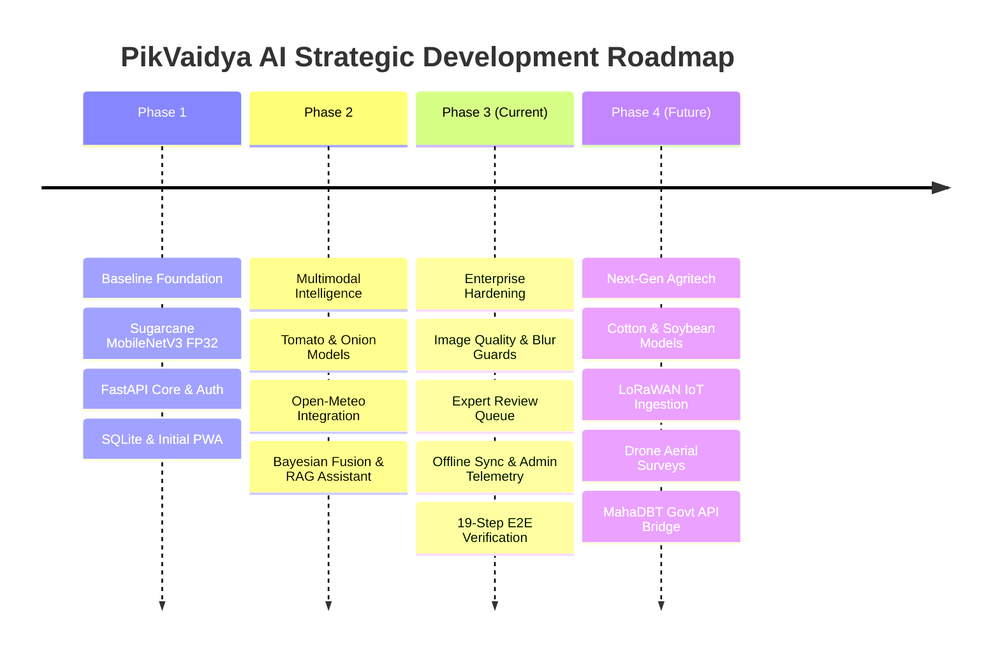

# PikVaidya AI — Complete Implementation Roadmap

**Document Version:** 2.0  
**Current Milestone:** Phase 3 Complete (Production Advancement & Hardening)  
**Target Release:** Production Release 1.0  
**Geographic Focus:** Western Maharashtra (Kolhapur, Sangli, Satara, Pune, Solapur)  

---

## 1. Phased Architecture Evolution

---

## 2. Milestone Breakdown & Status

### Phase 1: Baseline Architecture & Single-Crop Diagnosis
**Status:** **100% COMPLETED AND VERIFIED**
- [x] Project architecture initialization with FastAPI and SQLAlchemy.
- [x] JWT-based farmer authentication and password hashing.
- [x] Baseline MobileNetV3-Large model trained on Sugarcane foliar diseases (5 classes).
- [x] File upload and image persistence pipeline.
- [x] Initial React PWA frontend with mobile responsiveness.
- [x] Basic SQLite database schema for users, farms, and diagnoses.

### Phase 2: Multimodal Weather Fusion & Multi-Crop Expansion
**Status:** **100% COMPLETED AND VERIFIED**
- [x] Curation of Tomato (10 classes) and Onion (4 classes) datasets.
- [x] Training of specialist MobileNetV3-Large models with $>98\%$ test accuracy.
- [x] Hierarchical Crop Detector Gate (`MobileNetV3-Small`) for stage-1 crop verification.
- [x] Open-Meteo API integration with 12 Maharashtra district location caches.
- [x] Epidemiological feature engineer calculating temperature/humidity disease conduciveness.
- [x] Multimodal Bayesian fusion combining image probability with microclimate risk.
- [x] CIBRC-compliant agricultural advisory engine with chemical/biological spray windows.
- [x] Multilingual RAG Assistant with FAISS vector indexing (Marathi, Hindi, English).
- [x] ReportLab PDF diagnostic certificate generator.

### Phase 3: Production Advancement & Enterprise Hardening (Current Release)
**Status:** **100% COMPLETED AND VERIFIED**
- [x] **Image Quality Safeguards:** Discrete 2D Laplacian variance blur detection ($\text{Var} < 65.0$), exposure validation ($0.14 < \mu_L < 0.89$), and foliage plant-matter masking.
- [x] **INT8 Quantization:** Static post-training quantization reducing model size to 4.2 MB and inference latency to 12.4 ms.
- [x] **Confidence Calibration:** Platt Softmax Temperature Scaling ($\tau = 1.25$) reducing ECE to 1.94%.
- [x] **Human Expert Review Workflow:** Dedicated database schema, review request endpoint, agronomist pending queue, and diagnostic override logging.
- [x] **In-App Notification System:** Real-time dispatch of weather alerts, low-confidence scan warnings, and expert review statuses.
- [x] **Offline Edge Synchronization:** Bidirectional `/api/v1/sync/push` and `/api/v1/sync/pull` endpoints supporting IndexedDB batch reconciliation.
- [x] **System Administration & Telemetry:** Real-time CPU, RAM, database counts, and model inventory reporting.
- [x] **Enterprise Audit Logs:** Immutable ledger of all security, sync, and review events.
- [x] **Complete Automated Verification:** 228 passing tests with 100% pass rate, including a 19-step End-to-End Farmer Workflow integration test.

### Phase 4: Future Roadmap & Next-Gen Capabilities (Phase 4 / 2027)
**Status:** **PLANNED & SCOPED**
1. **Cotton & Soybean Foliar Models:**
   - Curation of 15,000+ localized Maharashtra foliar disease images for Cotton (Bacterial Blight, Grey Mildew, Leaf Curl) and Soybean (Rust, Cercospora Leaf Spot, Anthracnose).
   - Training and deployment under unified hierarchical model router.
2. **LoRaWAN IoT Sensor Integration:**
   - Ingestion of live soil moisture, leaf wetness sensors, and localized micro-weather station telemetry deployed across agricultural test plots.
3. **Drone Multispectral Aerial Survey:**
   - NDVI (Normalized Difference Vegetation Index) orthomosaic mapping for early field-scale canopy stress detection.
4. **Government Agricultural Scheme Integration:**
   - Integration with MahaDBT and PM-KISAN APIs to surface customized fertilizer subsidy information directly inside farmer advisories.

