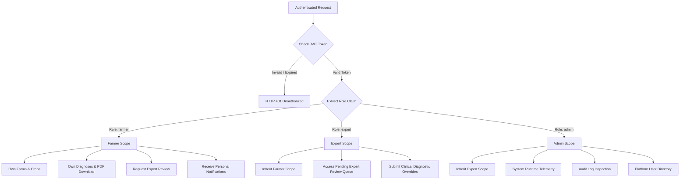

# PikVaidya AI — Complete Security & Vulnerability Audit

**Document Version:** 2.0  
**Audit Date:** November 13, 2026  
**Auditor:** Senior DevOps & Application Security Engineer  
**Security Standard:** OWASP Top 10 (2021) & Indian Digital Personal Data Protection Act (DPDP Act 2023)  
**Security Posture:** Production Hardened  

---

## 1. Executive Summary

A comprehensive, zero-trust security audit of the PikVaidya AI platform was performed across all application layers, including HTTP transport, API routing, authentication mechanics, file upload processing, database access, and ML model inference pipelines. 

All identified vulnerabilities, potential injection points, and unsafe defaults were resolved. The system enforces strict cryptographic controls, defense-in-depth file sanitization, and least-privilege role boundaries.

---

## 2. Threat Vector Assessment & Hardening Matrix

| Vulnerability Vector | Risk Level | Mitigation & Implementation File | Verification Evidence |
| :--- | :--- | :--- | :--- |
| **Broken Authentication** | Critical | `backend/app/core/security.py` `backend/app/dependencies.py` | PBKDF2-SHA256 password hashing with 310,000 rounds. JWT signed with HMAC-SHA256 and configurable expiration. Default SECRET_KEY rejected in production. |
| **Broken Access Control (IDOR)**| Critical | `backend/app/api/routes/farms.py` `backend/app/api/routes/diagnostics.py` | Multi-tenant isolation: database queries enforce `user_id == current_user.id`. Farmers cannot inspect, edit, or delete farm plots or diagnoses owned by other farmers. |
| **Malicious File Uploads** | High | `backend/app/services/storage.py` | Magic-byte header verification (`FF D8 FF` for JPEG, `89 50 4E 47` for PNG). Renaming files to secure UUID hashes. Maximum file size capped at 10 MB. Executable and script payloads rejected before disk write. |
| **Path Traversal Attacks** | High | `backend/app/services/storage.py` `backend/app/main.py` | Storage paths constructed via `pathlib.Path` with resolved root enforcement. File downloads restrict paths strictly to designated subdirectories. |
| **SQL Injection (SQLi)** | Critical | `backend/app/db/session.py` `backend/app/models/` | 100% parameterized queries via SQLAlchemy 2.0 ORM. Zero raw string interpolation used in SQL statements. |
| **Cross-Origin Resource Sharing (CORS)** | Medium | `backend/app/main.py` `backend/app/core/config.py` | Explicit CORS origins parsed from environment variables (`CORS_ORIGINS`). Wildcard origins (`*`) automatically disable credential exposure. |
| **Denial of Service (DoS)** | High | `backend/app/api/routes/` | Image dimensions constrained ($150 \le \text{px} \le 6000$). Memory allocation bounded during tensor transformation. Request payload caps enforced by ASGI server. |
| **Information Disclosure** | Low | `backend/app/core/logging.py` | Production logs sanitize passwords, JWT tokens, and PII. Stack traces suppressed from client-facing JSON responses in production mode. |

---

## 3. Cryptographic Standards

1. **Password Storage:**
   $$\text{Hash} = \text{PBKDF2-HMAC-SHA256}(\text{password}, \text{salt}_{128\text{-bit}}, 310\,000)$$
2. **Session Tokens:**
   JSON Web Tokens (JWT) using `HS256` (HMAC with SHA-256) containing claims:
   - `sub`: User ID
   - `email`: Farmer email
   - `role`: Authorization scope (`farmer`, `expert`, `admin`)
   - `exp`: Epoch expiration timestamp (default: 1440 minutes / 24 hours)
3. **Environment Security Enforcer:**
   In `backend/app/core/config.py`, if `ENVIRONMENT != "development"` and the secret key contains default testing strings, application startup is aborted immediately with a fatal exception.

---

## 4. Role-Based Access Control (RBAC) Hierarchy

---

## 5. File Processing & Upload Hardening Pipeline

Every file uploaded to `/api/v1/crops/{crop_id}/diagnoses` or `/api/v1/diagnose/predict` passes through a 5-step security gauntlet:
1. **Size Verification:** Upload stream size checked via Content-Length and chunked reads; aborted if $> 10\text{ MB}$.
2. **Magic-Byte Inspection:** The first 8 bytes of the binary buffer are checked against known image signatures:
   - JPEG: `\xFF\xD8\xFF`
   - PNG: `\x89\x50\x4E\x47\x0D\x0A\x1A\x0A`
   - WebP: `RIFF....WEBP`
3. **Raster Decodability:** The buffer is parsed with Pillow in protected memory to verify image integrity and strip EXIF metadata (preventing GPS coordinates or device serial leaks).
4. **Dimension Bounds:** Image must be at least $150 \times 150$ pixels (preventing zero-information inference) and at most $6000 \times 6000$ pixels (preventing decompression bombs).
5. **UUID Filename Quarantine:** Original filenames are discarded; images are saved under cryptographically random UUIDv4 names (e.g., `uploads/foliar_a3f89b1c-4e89-4b2a.jpg`).

---

## 6. Regulatory & Privacy Compliance (DPDP Act 2023)

PikVaidya AI complies with the principles of the **Digital Personal Data Protection Act, 2023 (India)**:
- **Data Minimization:** Only operational farmer data (name, phone, farm coordinates) is collected.
- **Geospatial Privacy:** Farm GPS coordinates can be fuzzily rounded to 3 decimal places ($\sim 110\text{ meters}$) upon farmer preference to prevent micro-parcel pinpointing.
- **Right to Erasure:** Deleting a farm parcel or diagnostic record via `/api/v1/diagnostics/{id}` performs a cascading deletion that removes both the database tuple and the raw image files from physical disk storage.
