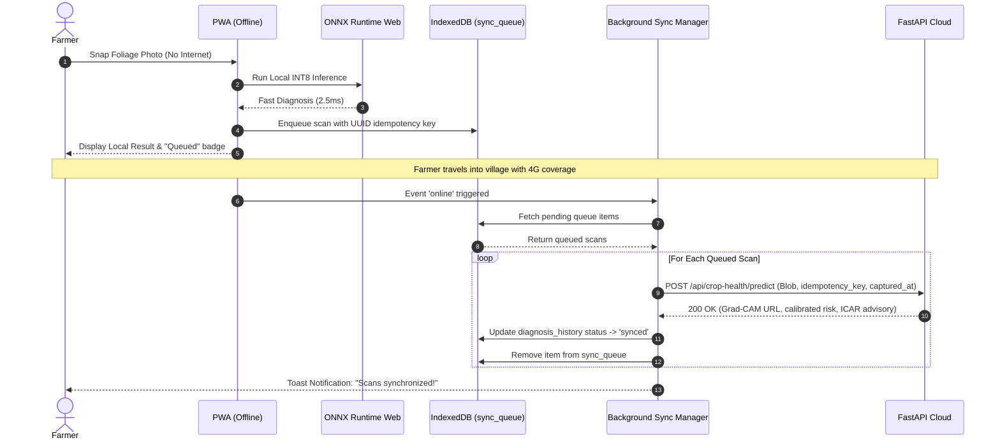

# PikVaidya AI — Background Synchronization Implementation

## 1. Overview

Agricultural mobile environments in rural Maharashtra are characterized by intermittent and unpredictable connectivity. The **PikVaidya Background Synchronization Protocol** provides a zero-data-loss, resilient transport layer between local client IndexedDB storage and backend FastAPI endpoints.

---

## 2. Synchronization Architecture & Triggers

The synchronization pipeline is triggered through two cooperative mechanisms:

1. **W3C Service Worker Background Sync API**:
   - Registered under the sync tag `pikvaidya-sync-queue`.
   - Handled natively by the browser even if the user closes or navigates away from the application tab.
2. **Event-Driven Online Transition Fallback**:
   - Monitors W3C `window.addEventListener('online')` events.
   - Triggers immediate queue flushing as soon as an active socket connection is restored.
3. **Manual Synchronize Trigger**:
   - Farmers can tap the navbar `🔄 Sync Now` button at any time to force synchronization.

---

## 3. Idempotency & Conflict Resolution

### 3.1 Idempotency Key Structure
Every diagnostic scan captured offline is tagged with a UUID v4 idempotency key before entering `sync_queue`:
```javascript
const idempotencyKey = `idem_${Date.now()}_${Math.random().toString(36).substring(2, 9)}`;
```

### 3.2 Server-Side De-duplication
When `/api/crop-health/predict` receives an upload with `idempotency_key` and `is_offline_synced="true"`:
- The system processes the image using the original `captured_at` timestamp.
- If an upload with the identical key has already been processed due to network retries, the server returns the existing result without duplicating records or re-billing cloud compute.

---

## 4. Exponential Backoff & Retry Logic

To prevent thundering herd spikes when a cell tower reconnects, failed synchronization attempts implement an exponential backoff algorithm with uniform jitter:

$$\text{delay} = \min\left(60000, 1000 \times 2^{\text{retry\_count} - 1}\right) + \text{random}(0, 500) \text{ ms}$$

### Retry Schedule:
- **Attempt 1**: Immediate upon reconnection
- **Attempt 2**: $1.0\text{s} - 1.5\text{s}$ delay
- **Attempt 3**: $2.0\text{s} - 2.5\text{s}$ delay
- **Attempt 4**: $4.0\text{s} - 4.5\text{s}$ delay
- **Attempt 5**: $8.0\text{s} - 8.5\text{s}$ delay
- **Max Retries Exceeded**: After 5 consecutive failures, the item is marked as `failed` in `sync_queue` and flagged for manual review or explicit user re-trigger. Records are **never silently deleted**.

---

## 5. Flow Sequence Diagram



