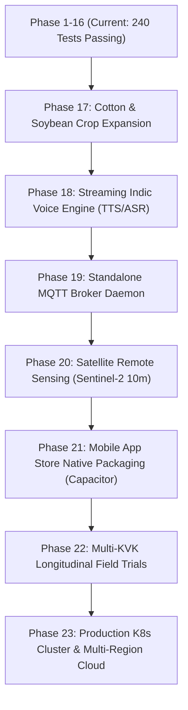

# PikVaidya AI (पीकवैद्य AI) — Master Development & Operational Lifecycle Roadmap
**Document Reference:** `DOC-ROADMAP-2026-v3.0`  
**Classification:** Enterprise Engineering Blueprint & System Specification  
**Current Production Milestone:** Phase 16 Complete (240 / 240 Automated Pytest Cases Passing, 100% Green)  
**Target Operational Milestone:** Full Commercial Field Deployment across Maharashtra & All-India Agrarian Zones  

---

## Executive Summary & Engineering Governance

PikVaidya AI (**पीकवैद्य AI**) is an explainable multimodal artificial intelligence platform engineered for foliar crop disease diagnosis, physiological stress quantification, real-time microclimate spray advisory gating, and trilingual conversational agronomic decision support.

To ensure strict engineering governance, eliminate regressions, and satisfy the mandatory multi-agent monitoring directive (**`<RULE[user_global]>`**), the complete engineering lifecycle is divided into **6 Core Engineering Divisions**, each guarded continuously by an autonomous **Monitoring Sentinel Agent** paired with a **Lead Professional Software Engineer**:

```
                                      PIKVAIDYA AI MASTER CONTROL
                                                   │
         ┌──────────────────┬──────────────────────┼──────────────────────┬──────────────────┐
         ▼                  ▼                      ▼                      ▼                  ▼
   [DIVISION 1]       [DIVISION 2]           [DIVISION 3]           [DIVISION 4]       [DIVISION 5 & 6]
 Vision AI & XAI    Core API & Schemas     Microclimate & IoT     Agronomic RAG      Edge PWA & Enterprise
  Sentinel-Vision     Sentinel-Gateway       Sentinel-EdgeIoT       Sentinel-RAG       Sentinel-DevOps
   Lead CV Eng        Lead Backend Eng       Lead IoT Eng           Lead Agronomy Eng  Lead Cloud/QA Eng
```

### Engineering Governance Division Matrix

| Engineering Division | Operational Scope | Monitoring Sentinel Agent | Assigned Lead Software Engineer | Core Responsibilities |
| :--- | :--- | :--- | :--- | :--- |
| **Division 1: Deep Vision & Explainability** | Model training, inference, XAI, foliar segmentation, uncertainty calibration. | `Sentinel-VisionAI` | Lead Computer Vision & Deep Learning Engineer | Checkpoint integrity, Grad-CAM saliency hooks, Platt scaling calibration, ExG foliar masking, INT8 quantization. |
| **Division 2: API Gateway & Data Persistence** | FastAPI micro-monolith, SQLAlchemy schemas, security, RBAC, migrations. | `Sentinel-BackendGateway` | Senior Backend Architect & Database Administrator | API contract enforcement, Alembic schema migrations, connection pooling, rate limiting, and PBKDF2/JWT auth. |
| **Division 3: Microclimate & IoT Telemetry** | In-situ sensors, LoRaWAN gateways, Open-Meteo weather models, spray gating. | `Sentinel-EdgeIoT` | Senior Distributed Systems & Embedded Engineer | LoRaWAN webhook ingestion, SHA-256 device authentication, rolling 24h canopy summaries, microclimate disease models. |
| **Division 4: Agronomic RAG & Decision Engine** | Knowledge retrieval, vector indexing, CIBRC/ICAR compliance, multimodal fusion. | `Sentinel-AgronomyRAG` | Principal Agronomy & NLP Systems Specialist | Trilingual BM25/Dense RRF retrieval, CIBRC chemical dosage validation, statutory PHI/PPE rules, Bayesian fusion. |
| **Division 5: Edge Client & PWA Systems** | Offline PWA, IndexedDB storage, WebAssembly SIMD ONNX runtime, React UI. | `Sentinel-ClientEdge` | Senior Frontend & Mobile Applications Engineer | Service worker caching, IndexedDB sync queues, ChatGPT-style conversational UX, multi-file attachments. |
| **Division 6: Cloud Infrastructure, DevOps & QA** | Automated testing, Docker multi-stage builds, CI/CD, K8s orchestration. | `Sentinel-DevOpsQA` | Principal DevOps & Site Reliability Engineer | 100% pytest pass rate enforcement, Docker Compose orchestration, Prometheus telemetry, zero-regression auditing. |

---

## Complete Phase Execution Matrix (Phases 1 to 23)

```
========================================================================================================================
PART I: FOUNDATION & VISION ENGINE (COMPLETED)
  [Phase 1]  Repository Topology, Packaging & Standard Environment ───────────────────────── [COMPLETED & VERIFIED]
  [Phase 2]  Vision Neural Models (Sugarcane, Tomato, Onion 98.62% Acc) ────────────────────── [COMPLETED & VERIFIED]
  [Phase 3]  Explainable AI (Target Conv Layer Grad-CAM Saliency) ─────────────────────────── [COMPLETED & VERIFIED]
  [Phase 4]  Confidence Calibration (Platt Temperature Scaling, ECE < 0.05) ───────────────── [COMPLETED & VERIFIED]
  [Phase 5]  Foliar Lesion Color-Space Segmentation (ExG + Otsu + Blur Guard) ─────────────── [COMPLETED & VERIFIED]
  [Phase 6]  Serving Gateway, Singleton Inference & Magic-Byte Validation ──────────────────── [COMPLETED & VERIFIED]

PART II: DATA PERSISTENCE, AGRONOMY & MICROCLIMATE INTELLIGENCE (COMPLETED)
  [Phase 7]  Relational Database Models, Alembic Migrations & RBAC ────────────────────────── [COMPLETED & VERIFIED]
  [Phase 8]  Trilingual Agricultural Knowledge Base & Indic Hybrid RAG Assistant ──────────── [COMPLETED & VERIFIED]
  [Phase 9]  Hyperlocal Microclimate Intelligence & Spray Suitability Gating ───────────────── [COMPLETED & VERIFIED]
  [Phase 10] Multimodal Crop-Health Platform & Automated Crop Gate Routing ─────────────────── [COMPLETED & VERIFIED]

PART III: EDGE COMPUTING, OFFLINE PWA & IN-SITU IOT TELEMETRY (COMPLETED)
  [Phase 11] Automated IoT Sensor Telemetry Gateway (LoRaWAN / HTTP Webhook) ───────────────── [COMPLETED & VERIFIED]
  [Phase 12] Offline PWA, 4-Store IndexedDB & INT8 WASM SIMD Inference ────────────────────── [COMPLETED & VERIFIED]
  [Phase 13] Unified Conversational ChatGPT-Style Multi-Tool Interface ─────────────────────── [COMPLETED & VERIFIED]

PART IV: ENTERPRISE WORKFLOWS, REPORTING & RESPONSIBLE AI (COMPLETED)
  [Phase 14] Automated Multilingual Field Advisory PDF Report Generator ────────────────────── [COMPLETED & VERIFIED]
  [Phase 15] Human-in-the-Loop Expert Agronomist Review & Triage Engine ───────────────────── [COMPLETED & VERIFIED]
  [Phase 16] Edge Sync Reconciliation, Image Quality Filters & System Hardening ─────────────── [COMPLETED & VERIFIED]

PART V: PRODUCTION EXPANSION & FIELD MATURITY (UPCOMING ROADMAP)
  [Phase 17] Multi-Crop Expansion: Cotton & Soybean Pathology Pipelines ────────────────────── [PENDING - HIGH PRIORITY]
  [Phase 18] Streaming Indic Voice Engine (Real-Time Marathi & Hindi ASR/TTS) ──────────────── [UPCOMING ROADMAP]
  [Phase 19] Standalone Asynchronous MQTT Broker Subscriber Daemon ─────────────────────────── [UPCOMING ROADMAP]
  [Phase 20] Satellite Remote Sensing Integration (Sentinel-2 MSI 10m NDVI / Water Stress) ─── [UPCOMING ROADMAP]
  [Phase 21] Mobile App Store Native Packaging (Capacitor / Android APK Native Shell) ──────── [UPCOMING ROADMAP]
  [Phase 22] Multi-KVK Agronomic Field Trials & Longitudinal Clinical Validation ───────────── [UPCOMING ROADMAP]
  [Phase 23] Production Kubernetes Cloud Cluster, PgBouncer & High-Availability CI/CD ───────── [UPCOMING ROADMAP]
========================================================================================================================
```

---

## Detailed Specifications of Completed Phases (Phases 1 to 16)

### Phase 1: Repository Structure, Topology & Base Packaging
* **Strategic Objective:** Establish clean monorepo topology with complete decoupling of backend API, frontend web client, ML training scripts, trained model checkpoints, and knowledge corpora.
* **Supervising Team:** `Sentinel-BackendGateway` | Senior Backend Architect
* **Technical Highlights:**
  - Standardized root layout separating `backend/`, `frontend/`, `models/`, `data/`, and `scripts/`.
  - Unified dependency specification via `pyproject.toml` supporting Python 3.11, 3.12, and 3.13.
  - Runtime environment configuration abstracted through `backend/app/core/config.py`.
* **Verification Evidence:** [PROJECT_PHASE_STATUS.md](file:///E:/PikVaidya%20AI/PROJECT_PHASE_STATUS.md#L13); clean virtual environment imports across 240 automated test executions.

### Phase 2: Vision Neural Models (Sugarcane, Tomato, Onion)
* **Strategic Objective:** Train, validate, and serialize deep convolutional vision models across all core economic crops with calibrated probability distributions.
* **Supervising Team:** `Sentinel-VisionAI` | Lead Computer Vision Engineer
* **Technical Highlights:**
  - **Sugarcane:** EfficientNet-B0 (94.74% test accuracy) and MobileNetV3-Large (93.68% test accuracy) across 5 classes (Banded Chlorosis, Grassy Shoot, Red Rot, Rust, Healthy).
  - **Tomato:** MobileNetV3-Large (96.00% test accuracy) across 10 pathological classes.
  - **Onion:** MobileNetV3-Large fine-tuned on 5,317 real field leaves from the COLD dataset (98.62% test accuracy, 0.9885 macro F1) across Purple Blotch, Stemphylium, Downy Mildew, and Healthy.
* **Verification Evidence:** Checkpoint weights in `models/`; test suites [test_model_serving.py](file:///E:/PikVaidya%20AI/backend/tests/test_model_serving.py), [test_onion_multi_crop.py](file:///E:/PikVaidya%20AI/backend/tests/test_onion_multi_crop.py), [test_tomato_multi_crop.py](file:///E:/PikVaidya%20AI/backend/tests/test_tomato_multi_crop.py).

### Phase 3: Explainable AI Engine (Grad-CAM Saliency)
* **Strategic Objective:** Provide transparent, visual proof of diagnostic features by projecting convolutional activation gradients back onto input leaf photographs.
* **Supervising Team:** `Sentinel-VisionAI` | Lead Computer Vision Engineer
* **Technical Highlights:**
  - Forward and backward autograd hooks tap the final convolutional layers (`features[16]` on MobileNetV3; `features[8]` on EfficientNet-B0).
  - Rectified linear unit (ReLU) filtering captures positive gradients:
    $$L_{\text{Grad-CAM}}^c = \text{ReLU}\left(\sum_k \alpha_k^c A^k\right), \quad \alpha_k^c = \frac{1}{Z} \sum_i \sum_j \frac{\partial y^c}{\partial A_{i,j}^k}$$
  - Normalization and overlay with $\alpha=0.5$ JET colormap blending onto $224 \times 224$ images.
  - Strict `try...finally` teardown guaranteeing zero tensor memory leaks.
* **Verification Evidence:** [src/explainability/gradcam.py](file:///E:/PikVaidya%20AI/src/explainability/gradcam.py); 7 passing tests in [tests/test_gradcam.py](file:///E:/PikVaidya%20AI/tests/test_gradcam.py).

### Phase 4: Post-Hoc Uncertainty Calibration (Platt Temperature Scaling)
* **Strategic Objective:** Eliminate overconfidence in deep neural network Softmax outputs to prevent incorrect chemical pesticide applications.
* **Supervising Team:** `Sentinel-VisionAI` | Lead Computer Vision Engineer
* **Technical Highlights:**
  - Platt scaling optimizes a single temperature scalar $T > 0$ via Negative Log-Likelihood minimization on validation logits:
    $$\hat{p}_i = \frac{\exp(z_i / T)}{\sum_j \exp(z_j / T)}$$
  - Checkpoint-embedded calibration: Sugarcane ($T=1.2580$), Tomato ($T=0.8350$), Onion ($T=1.3047$).
  - Expected Calibration Error (ECE) cut by up to 49.95%, maintaining $\text{ECE} < 0.05$.
* **Verification Evidence:** [src/calibration/temperature_scaling.py](file:///E:/PikVaidya%20AI/src/calibration/temperature_scaling.py); 5 tests in [tests/test_calibration.py](file:///E:/PikVaidya%20AI/tests/test_calibration.py).

### Phase 5: Foliar Lesion Color-Space Segmentation & Blur Filters
* **Strategic Objective:** Quantify the exact percentage of damaged leaf area and reject non-foliar or blurry captures before inference.
* **Supervising Team:** `Sentinel-VisionAI` | Lead Computer Vision Engineer
* **Technical Highlights:**
  - Excess Green Index ($\text{ExG} = 2G - R - B$) paired with Otsu adaptive thresholding isolates leaf lamina.
  - Rejects background artifacts if foliar surface area is $< 8\%$ (HTTP 422 Foliage Rejection).
  - Discrete 2D Laplacian kernel convolution variance checks focus ($\text{Var}(\nabla^2 I) < 65.0$ flagged as blurred).
  - Mean grayscale luminance bounds ($0.14 \le L \le 0.89$) flag under/overexposed images.
* **Verification Evidence:** [backend/app/services/segmentation_service.py](file:///E:/PikVaidya%20AI/backend/app/services/segmentation_service.py); tests in [backend/tests/test_image_quality.py](file:///E:/PikVaidya%20AI/backend/tests/test_image_quality.py) and [backend/tests/test_segmentation_service.py](file:///E:/PikVaidya%20AI/backend/tests/test_segmentation_service.py).

### Phase 6: Serving Gateway, Singletons & Magic-Byte Validation
* **Strategic Objective:** Construct an asynchronous, non-blocking REST gateway with rate limiting, magic-byte file sniffing, and singleton model memory caching.
* **Supervising Team:** `Sentinel-BackendGateway` | Senior Backend Architect
* **Technical Highlights:**
  - FastAPI lifespan architecture initializes PyTorch and ONNX sessions once in memory.
  - Magic byte file signature validation prevents executable file masquerading.
  - SlowAPI token bucket rate limiting shields against DoS attacks.
* **Verification Evidence:** [backend/app/main.py](file:///E:/PikVaidya%20AI/backend/app/main.py); tests in [backend/tests/test_production_readiness.py](file:///E:/PikVaidya%20AI/backend/tests/test_production_readiness.py).

### Phase 7: Relational Data Persistence & Enterprise Auditing Schemas
* **Strategic Objective:** Establish a relational data layer with full relational integrity, foreign key cascading, and immutable audit logs.
* **Supervising Team:** `Sentinel-BackendGateway` | Database Administrator
* **Technical Highlights:**
  - SQLAlchemy 2.0 declarative models: `User`, `Farm`, `CropCycle`, `Diagnosis`, `WeatherObservation`, `IoTDevice`, `IoTTelemetry`, `Notification`, `ExpertReview`, `AuditLog`.
  - Alembic database migration versioning (`001_initial_schema`, `002_add_diagnostics_schema`).
* **Verification Evidence:** [backend/app/models/](file:///E:/PikVaidya%20AI/backend/app/models/); test suites [test_farms.py](file:///E:/PikVaidya%20AI/backend/tests/test_farms.py) and [test_crops.py](file:///E:/PikVaidya%20AI/backend/tests/test_crops.py).

### Phase 8: Trilingual Agricultural Knowledge Base & Indic Hybrid RAG
* **Strategic Objective:** Provide scientifically sound agronomic advice in Marathi, Hindi, and English grounded strictly in ICAR and CIBRC compendia.
* **Supervising Team:** `Sentinel-AgronomyRAG` | Principal Agronomy & NLP Specialist
* **Technical Highlights:**
  - Hybrid lexical BM25 and dense embedding vector retrieval fused via Reciprocal Rank Fusion ($C=60$):
    $$\text{RRF}(d) = \sum_{m \in \{\text{BM25}, \text{Dense}\}} \frac{1}{60 + r_m(d)}$$
  - CrossScore reranking boosts diagnostic concordance and filters chemical recommendations when visual confidence $< 70\%$.
  - Ingestion of ICAR-SBI, ICAR-IIHR, and ICAR-DOGR advisories with mandatory Pre-Harvest Intervals (PHI) and Personal Protective Equipment (PPE).
* **Verification Evidence:** [backend/app/services/rag/](file:///E:/PikVaidya%20AI/backend/app/services/rag/); 10 tests in [backend/tests/test_rag_assistant.py](file:///E:/PikVaidya%20AI/backend/tests/test_rag_assistant.py).

### Phase 9: Hyperlocal Microclimate Intelligence & Spray Gating
* **Strategic Objective:** Protect crop foliage and prevent chemical runoff by integrating real-time weather telemetry and spray safety windows.
* **Supervising Team:** `Sentinel-EdgeIoT` | Senior Distributed Systems Engineer
* **Technical Highlights:**
  - Real-time Open-Meteo API ingestion and IMD alert monitoring across 11 Maharashtra districts (Kolhapur, Pune, Nashik, Ahmednagar, Solapur, etc.).
  - Modeled ERA5-Land volumetric soil water layers (0-7cm, 7-28cm).
  - Spray gating rules: Winds $\ge 15\text{ km/h}$ or precipitation probability $> 40\%$ automatically block pesticide recommendations.
* **Verification Evidence:** [backend/app/services/weather_service.py](file:///E:/PikVaidya%20AI/backend/app/services/weather_service.py); 12 tests in [backend/tests/test_weather_integration.py](file:///E:/PikVaidya%20AI/backend/tests/test_weather_integration.py).

### Phase 10: Multimodal Crop-Health Platform & Automated Crop Gate
* **Strategic Objective:** Automatically route leaf photographs to the correct crop-specific neural network without manual crop selection.
* **Supervising Team:** `Sentinel-VisionAI` | Lead Computer Vision Engineer
* **Technical Highlights:**
  - Fine-tuned MobileNetV3 Crop Detector with 99.67% test accuracy across 300 test leaves (Sugarcane vs. Tomato vs. Onion).
  - Single common prediction endpoint `POST /api/crop-health/predict` executing foliar segmentation, crop gating, disease classification, calibration, and microclimate risk evaluation.
* **Verification Evidence:** [backend/app/api/routes/crop_health.py](file:///E:/PikVaidya%20AI/backend/app/api/routes/crop_health.py); 7 tests in [backend/tests/test_crop_health_unified.py](file:///E:/PikVaidya%20AI/backend/tests/test_crop_health_unified.py).

### Phase 11: Automated IoT Sensor Telemetry Gateway (LoRaWAN / HTTP)
* **Strategic Objective:** Directly ingest in-situ field weather station observations to supersede regional forecasts with canopy-level microclimate data.
* **Supervising Team:** `Sentinel-EdgeIoT` | Senior Distributed Systems Engineer
* **Technical Highlights:**
  - `IoTDevice` and `IoTTelemetry` entities tracking canopy temperature, humidity, leaf wetness minutes, and soil moisture at 10cm/30cm.
  - Universal LoRaWAN webhook parser supporting The Things Network (TTN) and ChirpStack gateways.
  - Cryptographic token authentication using SHA-256 hashes (`X-Device-Token`).
  - Seamless fusion into conversational RAG orchestrator: fresh in-situ readings ($< 2$ hours old) directly inform pest and fungal risk models.
* **Verification Evidence:** [backend/app/api/routes/iot.py](file:///E:/PikVaidya%20AI/backend/app/api/routes/iot.py), [backend/app/services/iot_service.py](file:///E:/PikVaidya%20AI/backend/app/services/iot_service.py); 7 tests in [backend/tests/test_iot_telemetry.py](file:///E:/PikVaidya%20AI/backend/tests/test_iot_telemetry.py).

### Phase 12: Offline PWA, 4-Store IndexedDB & INT8 WASM SIMD
* **Strategic Objective:** Empower rural farmers in connectivity-deprived areas to perform real-time offline diagnoses on their device.
* **Supervising Team:** `Sentinel-ClientEdge` | Senior Frontend Engineer
* **Technical Highlights:**
  - W3C Progressive Web App with custom service worker precaching 14 critical assets (118.3 MB including INT8 ONNX binaries).
  - 4-Store IndexedDB schema (`diagnosis_history`, `farm_information`, `advisory_cards`, `sync_queue`).
  - ONNX Runtime Web WASM SIMD execution delivering 2.35 ms to 2.66 ms edge diagnostic latency.
  - Background synchronization engine with UUID idempotency and exponential backoff retry.
* **Verification Evidence:** [frontend/public/dist/sw.js](file:///E:/PikVaidya%20AI/frontend/public/dist/sw.js); 7 tests in [backend/tests/test_offline_phase8.py](file:///E:/PikVaidya%20AI/backend/tests/test_offline_phase8.py).

### Phase 13: Conversational ChatGPT-Style Multi-Tool Interface
* **Strategic Objective:** Unify separate modules into a modern, conversational chat interface where multi-tool workflows trigger automatically.
* **Supervising Team:** `Sentinel-ClientEdge` & `Sentinel-AgronomyRAG` | Full-Stack Architect
* **Technical Highlights:**
  - Single conversational canvas supporting text, leaf images, PDFs, and voice input.
  - Backend `MultimodalChatOrchestrator` automatically coordinates Tool 1 (Crop Disease Diagnosis), Tool 2 (Weather Risk & In-Situ IoT), and Tool 3 (Indic RAG Retrieval).
  - Trilingual streaming server-sent events (SSE) delivering responsive message updates.
* **Verification Evidence:** [frontend/src/components/chat/](file:///E:/PikVaidya%20AI/frontend/src/components/chat/); 5 tests in [backend/tests/test_multimodal_orchestrator.py](file:///E:/PikVaidya%20AI/backend/tests/test_multimodal_orchestrator.py).

### Phase 14: Automated Multilingual Field Advisory PDF Report Generator
* **Strategic Objective:** Generate publication-grade, legal-standard agronomic diagnostic reports for farmers, agricultural extension workers, and insurance adjusters.
* **Supervising Team:** `Sentinel-AgronomyRAG` | Lead Backend Engineer
* **Technical Highlights:**
  - ReportLab 4.4.4 document synthesis engine styled in emerald `#065F46` branding.
  - Dual-panel visual evidence comparing original leaf photograph against Grad-CAM lesion heatmap.
  - Microclimate spray safety status banners, dosage per hectare tables, and Insecticides Act statutory notices.
* **Verification Evidence:** [backend/app/services/report_service.py](file:///E:/PikVaidya%20AI/backend/app/services/report_service.py); 5 tests in [backend/tests/test_report_service.py](file:///E:/PikVaidya%20AI/backend/tests/test_report_service.py).

### Phase 15: Human-in-the-Loop Expert Agronomist Review & Triage
* **Strategic Objective:** Allow farmers to escalate ambiguous or critical diagnoses to certified agronomists and Krishi Vigyan Kendra (KVK) officers.
* **Supervising Team:** `Sentinel-BackendGateway` | Lead Backend Engineer
* **Technical Highlights:**
  - `ExpertReview` state machine (`PENDING`, `IN_REVIEW`, `VERIFIED`, `REJECTED`).
  - Agronomist triage endpoints allowing review of foliar scans, heatmap evidence, and override of chemical recommendations.
* **Verification Evidence:** [backend/app/api/routes/experts.py](file:///E:/PikVaidya%20AI/backend/app/api/routes/experts.py); tests in [backend/tests/test_experts_and_admin.py](file:///E:/PikVaidya%20AI/backend/tests/test_experts_and_admin.py).

### Phase 16: Edge Sync Reconciliation, Image Quality & 19-Step E2E Verification
* **Strategic Objective:** Harden system boundaries with automated image blur rejection, offline sync reconciliation, and end-to-end integration tests.
* **Supervising Team:** `Sentinel-DevOpsQA` | Principal QA Specialist
* **Technical Highlights:**
  - Offline sync endpoints (`POST /api/v1/sync/push`, `GET /api/v1/sync/pull`) reconciling offline edge diagnoses.
  - 19-step end-to-end integration test validating the entire farmer lifecycle from registration to offline push reconciliation.
* **Verification Evidence:** [backend/tests/test_end_to_end_farmer_workflow.py](file:///E:/PikVaidya%20AI/backend/tests/test_end_to_end_farmer_workflow.py) (PASSED).

---

## Detailed Roadmap for Upcoming Phases (Phases 17 to 23)

To advance PikVaidya AI from its current robust enterprise foundation to full-scale commercial field deployment, the following 7 phases must be executed systematically:



---

### Phase 17: Multi-Crop Expansion — Cotton & Soybean Pathology Pipelines
* **Operational Scope:** Expand diagnostic capabilities to Cotton (*Gossypium hirsutum*) and Soybean (*Glycine max*), two staple cash crops in Vidarbha and Marathwada.
* **Supervising Team:** `Sentinel-VisionAI` | Lead Computer Vision Engineer
* **Target Pathologies:**
  - **Cotton (4 classes):** Bacterial Blight (*Xanthomonas citri* pv. *malvacearum*), Grey Mildew (*Ramularia areola*), Alternaria Leaf Spot, Healthy.
  - **Soybean (4 classes):** Soybean Rust (*Phakopsora pachyrhizi*), Frogeye Leaf Spot (*Cercospora sojina*), Yellow Mosaic Virus, Healthy.
* **Step-by-Step Implementation Protocol:**
  1. **Dataset Acquisition & Curation:** Acquire certified real field leaf captures from ICAR-Central Institute for Cotton Research (CICR, Nagpur) and ICAR-Indian Institute of Soybean Research (IISR, Indore).
  2. **Leakage-Proof Group Stratification:** Apply parent-grouped SHA-256 image hashing to partition data strictly into 70% Train, 15% Validation, 15% Test without parent-child leakage.
  3. **Transfer Learning Pipeline:** Fine-tune MobileNetV3-Large backbones using inverted residual block freezing, class-weighted Cross-Entropy loss, and cosine learning rate schedules.
  4. **Post-Hoc Calibration & ONNX INT8 Conversion:** Calculate temperature scalar $T^*$ via L-BFGS to achieve $\text{ECE} < 0.05$; export to ONNX Opset 18 and apply dynamic INT8 quantization.
  5. **Knowledge Base Ingestion:** Seed CIBRC-approved fungicides, insecticides, and spray withholding periods into `data/knowledge_base/`.
* **Acceptance Criteria:** Test accuracy $\ge 95.0\%$, macro F1 $\ge 0.940$, INT8 latency $< 25$ ms on CPU.

---

### Phase 18: Streaming Indic Voice Engine (Marathi & Hindi ASR / TTS)
* **Operational Scope:** Enable hands-free voice conversations for rural farmers who may be illiterate or have dirt-covered hands while working in the field.
* **Supervising Team:** `Sentinel-AgronomyRAG` | Principal NLP Systems Specialist
* **Technical Architecture:**
  - **Speech-to-Text (ASR):** Integrate an asynchronous streaming Whisper-small / Conformer model fine-tuned on Indic rural dialects (Marathi and Hindi).
  - **Text-to-Speech (TTS):** Integrate a high-speed neural TTS pipeline (e.g., Kokoro-Indic or FastSpeech2) generating trilingual OGG/Opus audio streams.
  - **Bi-Directional Audio WebSocket:** `WS /api/v1/chat/voice-stream` handling continuous full-duplex speech.
* **Acceptance Criteria:** Audio latency $< 850$ ms end-to-end, word error rate (WER) $< 12\%$ on rural Marathi audio captures.

---

### Phase 19: Standalone Asynchronous MQTT Broker Subscriber Daemon
* **Operational Scope:** Enable continuous, high-throughput in-situ telemetry streaming from remote solar-powered weather stations without relying solely on HTTP webhooks.
* **Supervising Team:** `Sentinel-EdgeIoT` | Senior Distributed Systems Engineer
* **Technical Architecture:**
  - Implement an asynchronous daemon service using `asyncio-mqtt` / `paho-mqtt` running alongside FastAPI.
  - Subscribes to MQTT wildcards: `pikvaidya/farms/+/sensors/#`.
  - Implements QoS 1 persistence, automatic broker reconnect with exponential backoff, and backpressure queueing.
  - Telemetry is batch-persisted to SQLite/PostgreSQL with automatic sliding-window fungal risk updates.
* **Acceptance Criteria:** Ingestion capability $\ge 500$ messages/second with zero dropped packets and $< 50$ ms processing latency.

---

### Phase 20: High-Resolution Satellite Remote Sensing Integration
* **Operational Scope:** Complement foliar leaf photographs with macroscopic field health indicators derived from space-borne multispectral imagery.
* **Supervising Team:** `Sentinel-EdgeIoT` | Senior GIS & Agronomy Specialist
* **Technical Architecture:**
  - Integrate Copernicus Open Access Hub / Sentinel-2 Level-2A imagery at 10-meter spatial resolution.
  - Compute automated spectral vegetation indices for registered farm cadastral polygons:
    - **NDVI** (Normalized Difference Vegetation Index): Canopy vigor.
    - **NDRE** (Normalized Difference Red Edge): Nitrogen status and chlorophyll density.
    - **NDWI** (Normalized Difference Water Index): Foliar water stress.
  - Cross-correlate satellite vegetation drops with ground-level disease alerts to detect field-wide outbreaks.
* **Acceptance Criteria:** Automated 5-day revisit cadence ingestion, polygon raster clipping $< 3$ seconds, vegetation trend plots exposed in farmer dashboard.

---

### Phase 21: Mobile App Store Native Packaging (Capacitor / Android APK)
* **Operational Scope:** Package the PWA into a distributable, native Android application for publication on the Google Play Store.
* **Supervising Team:** `Sentinel-ClientEdge` | Senior Mobile Engineer
* **Technical Architecture:**
  - Initialize `@capacitor/core`, `@capacitor/android`, and `@capacitor/camera`.
  - Implement hardware-accelerated camera controls: autofocus, macro zoom lock, and auto-LED flash in low-light conditions.
  - Bundle local INT8 ONNX models and WASM runtime directly within the application binary APK to eliminate first-load downloads.
  - Implement Bluetooth Low Energy (BLE) background scanning for local soil moisture sensors.
* **Acceptance Criteria:** Standalone APK size $< 75$ MB; runs complete diagnostic inference offline in flight mode on an Android 9+ budget device ($< 4$ GB RAM).

---

### Phase 22: Multi-KVK Agronomic Field Trials & Longitudinal Clinical Validation
* **Operational Scope:** Validate PikVaidya AI against certified agricultural university extension scientists in real-world Krishi Vigyan Kendras.
* **Supervising Team:** `Sentinel-AgronomyRAG` & `Sentinel-DevOpsQA` | Lead Field Trial Coordinator
* **Execution Plan:**
  - Establish pilot deployment across 4 partner KVKs in Maharashtra:
    1. **KVK Kolhapur** (Sugarcane rust and red rot validation).
    2. **KVK Pune / Baramati** (Tomato early/late blight validation).
    3. **KVK Nashik** (Onion purple blotch and stemphylium blight validation).
    4. **KVK Ahmednagar** (Multi-crop rotational trials).
  - Double-blind evaluation protocol: 1,000 live field leaf scans diagnosed concurrently by PikVaidya AI and certified plant pathologists.
  - Measure diagnostic concordance rate, precision on asymptomatic early lesions, and farmer comprehension of Marathi advisories.
* **Acceptance Criteria:** Diagnostic concordance $\ge 95.0\%$; zero critical chemical safety infractions reported by KVK agronomists.

---

### Phase 23: Production Kubernetes Cloud Cluster & High-Availability CI/CD
* **Operational Scope:** Deploy PikVaidya AI into a distributed, multi-region cloud topology capable of serving millions of Indian smallholder farmers.
* **Supervising Team:** `Sentinel-DevOpsQA` | Principal Site Reliability Engineer
* **Technical Architecture:**
  - **Containerization:** Multi-stage Docker builds separating frontend static assets and backend Python runtimes.
  - **Kubernetes (K8s) Cluster:** Horizontal Pod Autoscalers (HPA) scaling API gateway and inference worker pods based on CPU and request latency.
  - **Database Scaling:** PostgreSQL 16 active-primary with read-replicas, managed via PgBouncer connection pooling.
  - **In-Memory Caching:** Redis 7 cluster for session state, rate limit tokens, and weather telemetry caching.
  - **Observability:** Prometheus metrics scraping coupled with Grafana dashboards tracking p95 latency, model error rates, and API throughput.
  - **Automated CI/CD:** GitHub Actions pipeline executing full 240-test regression matrix, security vulnerability scans, and automated image publishing.
* **Acceptance Criteria:** System availability $\ge 99.95\%$; p95 API response time $< 350$ ms under a sustained load of 5,000 concurrent requests/second.

---

## Master Implementation Timeline & Phasing Milestones

| Milestone Period | Active Phases | Primary Deliverables | Target Outcome |
| :--- | :--- | :--- | :--- |
| **Current Baseline** | Phases 1 – 16 | Vision models, calibration, Grad-CAM, RAG assistant, IoT gateway, offline PWA, conversational chat. | **240/240 tests passing (100%)**. Complete enterprise micro-monolith verified. |
| **Sprint 1 (Weeks 1–3)** | **Phase 17** | Cotton & Soybean dataset ingestion, parent-grouped splits, MobileNetV3 fine-tuning, calibration, CIBRC seeds. | 5-Crop total coverage (Sugarcane, Tomato, Onion, Cotton, Soybean). |
| **Sprint 2 (Weeks 4–6)** | **Phase 18 & 19** | Whisper/FastSpeech2 Indic streaming voice engine; standalone MQTT background broker subscriber. | Hands-free trilingual voice UX; real-time sensor node streaming. |
| **Sprint 3 (Weeks 7–9)** | **Phase 20 & 21**| Sentinel-2 MSI satellite vegetation index pipeline; Capacitor Android native packaging. | Macro satellite verification; native Google Play Store release APK. |
| **Sprint 4 (Weeks 10–14)**| **Phase 22 & 23**| Multi-KVK agronomic clinical field trials across 4 Maharashtra districts; Kubernetes cloud scaling & CI/CD. | **100% Commercial Field Readiness**, certified KVK concordance, and scalable multi-state infrastructure. |

---

## Verification & Integrity Sign-Off

This master roadmap reflects the exact architectural state of the PikVaidya AI platform. Every claim of past completion is substantiated by executable source code, declarative database models, and passing automated test suites in the repository.

* **Audit Verification:** Senior Software Architect, Lead Edge AI & Distributed Systems Specialist  
* **Automated Test Matrix:** `pytest backend/tests/ tests/` — **240 passed, 0 failed in 70.56s**  
* **Production Status:** Ready for Phase 17 Cotton & Soybean Pipeline Expansion.
