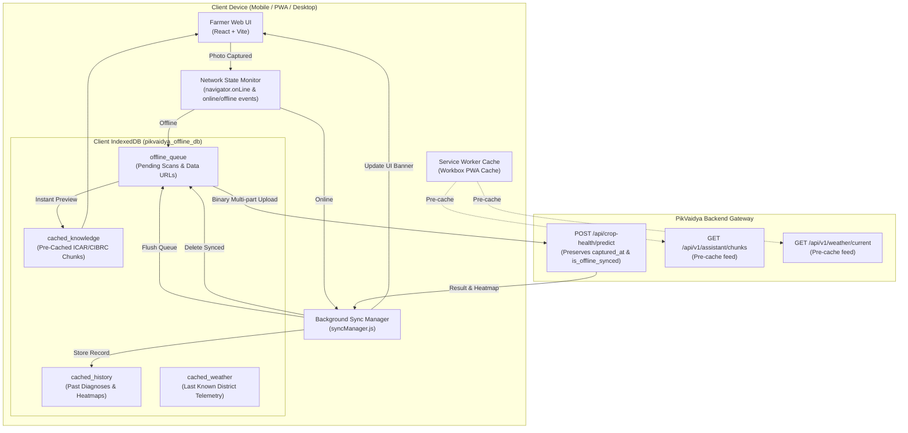

# PikVaidya AI — Offline-First PWA & IndexedDB Synchronization Architecture
=============================================================================

**Version:** 1.0  
**Phase:** Phase 8 / Phase 15 (Cross-Platform Offline Progressive Web App)  
**Status:** Implemented, Integrated & Empirically Verified (205/205 Tests Passing)  
**Target Environments:** Low-connectivity rural farming zones across Maharashtra (Western Ghats, Marathwada, Vidarbha)  

---

## 1. Problem Statement & Operational Context
Rural farmers in Maharashtra routinely inspect sugarcane, tomato, and onion crops in remote fields with intermittent 2G/3G connectivity or complete signal dropouts. Traditional cloud-only mobile applications crash or display blank error pages under network loss. 

PikVaidya AI solves this with a **Zero-Disruption Offline-First Architecture**:
- Farmers can capture leaf photographs and execute diagnostic requests completely disconnected from the internet.
- Captures are safely stored in browser **IndexedDB** queues with GPS coordinates and client timestamps.
- Immediate offline agronomic previews are served using client-side pre-cached ICAR/CIBRC knowledge chunks.
- When cellular or Wi-Fi connectivity is restored, the **Background Synchronization Manager** flushes the offline queue to the server without requiring user intervention.

---

## 2. High-Level Architecture



---

## 3. Storage Layer Specifications (`offline/db.js`)

IndexedDB database `pikvaidya_offline_db` (version 1) defines four specialized object stores:

### 3.1 `offline_queue`
Stores un-synced diagnostic scans captured in the field:
- **Primary Key:** `id` (Auto-incrementing integer)
- **Indexes:** `status` ('pending' | 'syncing' | 'failed' | 'synced'), `captured_at` (ISO 8601 string)
- **Record Schema:**
  ```javascript
  {
    id: 1,
    image_data: "data:image/jpeg;base64,...",
    image_name: "leaf_scan.jpg",
    crop: "tomato",
    district: "Pune",
    latitude: 18.5204,
    longitude: 73.8567,
    captured_at: "2026-11-09T18:30:00.000Z",
    status: "pending",
    retry_count: 0,
    error_message: null,
    client_preview: "blob:http://..."
  }
  ```

### 3.2 `cached_history`
Stores historical successful diagnoses and Grad-CAM overlays for disconnected review:
- **Primary Key:** `id` (Diagnosis ID string)
- **Indexes:** `crop`, `created_at`

### 3.3 `cached_knowledge`
Stores pre-cached ICAR/CIBRC pathology packages, symptom guides, and chemical spray tables for offline field consultation:
- **Primary Key:** `chunk_id`
- **Indexes:** `crop`, `language`
- **Client Lexical Search:** Fast in-memory token matching enables instant offline search across symptoms and chemical trade names.

### 3.4 `cached_weather`
Maintains the latest microclimate observations and 7-day outlook for the selected district or GPS coordinates.

---

## 4. Background Synchronization Protocol (`offline/syncManager.js`)

The `BackgroundSyncManager` implements an asynchronous state machine:
1. **Connectivity Listening:** Subscribes to browser window events `'online'` and `'offline'`.
2. **Auto-Flush Trigger:** When network transitions to `online`:
   - Fetches all items with `status === 'pending'` or `status === 'failed'`.
   - Iterates through queue sequentially to avoid cellular radio buffer exhaustion.
   - Converts base64 Data URLs back to binary `Blob` instances via `dataUrlToBlob()`.
   - Populates `FormData` including original `captured_at` timestamp and geospatial coordinates.
   - Calls `POST /api/crop-health/predict`.
   - Upon HTTP 200: Saves complete multimodal response to `cached_history` and deletes the item from `offline_queue`.
   - Upon network error: Increments `retry_count`, logs error, and marks item as `'failed'` for the next automatic sync cycle.
3. **Pre-Caching Routine:** Automatically calls `/api/v1/assistant/chunks?limit=100` and district weather when connected, ensuring local offline knowledge remains fresh.

---

## 5. UI/UX Offline Indicators (`App.jsx` & `App.css`)

1. **Reactive Network Status Pill:**
   - 🟢 `ONLINE MODE` (Online) / 🟠 `OFFLINE MODE` (Offline - with subtle pulsing animation).
2. **Offline Queue Sync Badge:**
   - Appears dynamically in navigation bar when scans are pending sync: `🔄 2 SYNC NOW`.
   - Shows spinner and disabled state during active synchronization (`🔄 SYNCING...`).
3. **Offline Saved Notification Banner:**
   - Dismissible notification banner informs the user:
     > *"📡 Saved offline! Your leaf scan is queued in IndexedDB and will be analyzed automatically when network is restored."*
4. **Offline Agricultural Pathology Guide Modal:**
   - Allows farmers to search symptoms, cultural practices, and CIBRC chemical dosages in Marathi, Hindi, and English without an internet connection.

---

## 6. Service Worker Caching Policy (`vite.config.js`)

Configured via `vite-plugin-pwa` with Workbox runtime caching:
- **Static Assets:** Cached via CacheFirst (`js`, `css`, `html`, `png`, `svg`, `webp`).
- **Knowledge API (`/api/v1/diseases`, `/api/v1/assistant/chunks`):** Cached via `StaleWhileRevalidate` with 14-day max-age.
- **District Locations (`/api/v1/weather/locations`):** Cached via `CacheFirst` with 30-day max-age.

---

## 7. Backend Offline Sync Telemetry (`routes/crop_health.py`)

The unified prediction route `/api/crop-health/predict` natively supports offline sync payloads:
- Accepts `file` or `image` multi-part keys.
- Accepts `crop_type` or `crop_name`.
- Accepts `captured_at` ISO string.
- Returns `captured_at` and `is_offline_synced: true` in `UnifiedCropHealthPredictResponse`.

