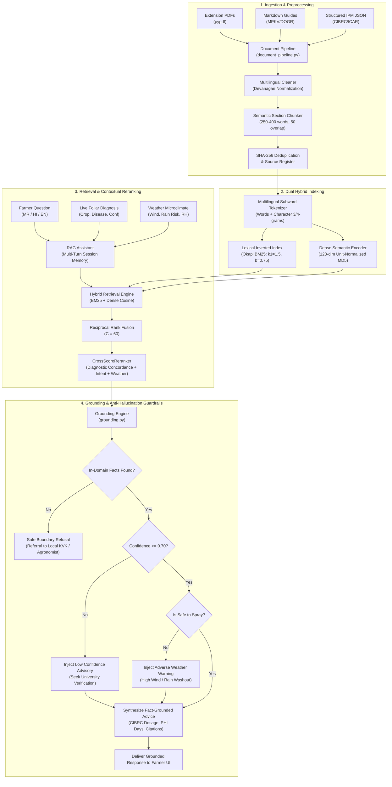

# PikVaidya AI — Agricultural RAG Architecture Specification
=============================================================

**Version:** 2.0  
**Status:** Implemented & Verified (186/186 Tests Passing)  
**Modules:** `indexer.py`, `document_pipeline.py`, `grounding.py`, `assistant.py`, `routes/assistant.py`  

---

## 1. High-Level Architecture Overview

The PikVaidya AI Agricultural RAG (Retrieval-Augmented Generation) system provides reliable, hallucination-free agronomic advice to farmers by harmonizing:
1. Multi-format agricultural documents (PDF, Markdown, JSON, Text).
2. Pure NumPy dense semantic hashing vectors (128 dimensions).
3. Inverted lexical Okapi BM25 indices ($k_1=1.5, b=0.75$).
4. Reciprocal Rank Fusion (RRF $C=60$).
5. Contextual CrossScoreReranker prioritizing live diagnostic findings and weather alerts.
6. Agricultural Grounding Engine enforcing CIBRC dosages, PHI days, and statutory disclaimers under the Insecticides Act, 1968.

---

## 2. Core Mathematical Specifications

### 2.1 Multilingual Subword Tokenization
- Handles Devanagari script (Marathi and Hindi) alongside English and botanical Latin.
- Extracts standard alphanumeric words, filters common language stop-words (`कोणती, आहे, काय, कसे, में, से, है`, etc.).
- For Devanagari words with length $\ge 4$, extracts character 3-grams and 4-grams to account for Indic agglutinative inflections (e.g. *उसावरील $\rightarrow$ [उसा, सावर, वरील, उसाव, सावरी, वरील]*).

### 2.2 Dense Semantic Feature Hashing
- Fast, zero-external-dependency neural projection into $\mathbb{R}^{128}$.
- Maps tokens using deterministic MD5 hashing:
  $$h = \text{MD5}(token)$$
  $$idx = h \pmod{128}$$
  $$sign = +1 \text{ if } (h \gg 7) \& 1 \text{ else } -1$$
  $$\vec{v}[idx] \mathrel{+}= sign$$
- The resulting vector is unit-normalized: $\hat{v} = \frac{\vec{v}}{\|\vec{v}\|_2}$.
- Cosine similarity between query and document vectors is computed via fast vector dot-product:
  $$S_{dense} = \hat{q} \cdot \hat{d}$$

### 2.3 Okapi BM25 Lexical Ranking
- Implemented with standard parameters $k_1 = 1.5, b = 0.75$:
  $$\text{IDF}(t) = \ln\left(1 + \frac{N - \text{DF}(t) + 0.5}{\text{DF}(t) + 0.5}\right)$$
  $$\text{BM25}(q, d) = \sum_{t \in q} \text{IDF}(t) \cdot \frac{\text{TF}(t, d) \cdot (k_1 + 1)}{\text{TF}(t, d) + k_1 \cdot \left(1 - b + b \cdot \frac{|d|}{\text{avgdl}}\right)}$$

### 2.4 Reciprocal Rank Fusion (RRF)
- Merges disparate score distributions into a robust reciprocal rank metric with constant $C = 60$:
  $$\text{RRF}(d) = \frac{1}{60 + \text{Rank}_{BM25}(d)} + \frac{1}{60 + \text{Rank}_{Dense}(d)}$$

### 2.5 CrossScoreReranker (Contextual Concordance)
Candidates from the top $3 \times K$ RRF pool undergo cross-scoring evaluation:
$$Score_{final} = \text{RRF}(d) + 0.10 \times \left( Boost_{diagnostic} + Boost_{intent} + Boost_{weather} \right)$$
Where:
- $Boost_{diagnostic} = +0.50$ (matching crop) $+ 1.50$ (matching disease).
- $Boost_{intent} = +0.80$ (matching chemical inquiry with chemical section) or $+0.60$ (symptoms/cultural/irrigation).
- $Boost_{weather} = +0.40$ (adverse weather matched with spray timing / delay precautions).

---

## 3. Anti-Hallucination & Legal Safety Protocols
1. **Out-of-Domain Refusal:** When zero relevant agricultural chunks are retrieved or cosine similarity $< 0.35$ with zero BM25 overlap, the system refuses to answer and redirects to the nearest Krishi Vigyan Kendra (KVK).
2. **Zero Invented Dosages:** All chemical names, concentrations, and dosages must be explicitly present in the retrieved chunk metadata verified by CIBRC.
3. **Pre-Harvest Interval (PHI):** Always cited to prevent toxic pesticide residue in harvest.
4. **Statutory Notices:** Automatically injects mandatory legal disclaimers under the Insecticides Act, 1968 in the user's preferred language (English, Marathi, Hindi).

