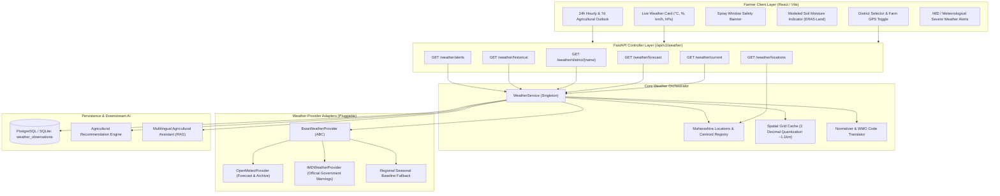

# PikVaidya AI — Agricultural Weather & Microclimate Integration Guide

**Document Version:** 1.0.0  
**Project:** PikVaidya AI  
**Module:** Enterprise Agricultural Weather Integration System  
**Author:** Senior Full-Stack Developer & Weather Integration Specialist  
**Date:** November 2026  

---

## 1. System Architecture Overview

The PikVaidya AI weather subsystem is engineered as a decoupled, multi-tiered service that delivers real-time ambient microclimate observations, modeled root-zone soil hydrology, multi-day agricultural forecast projections, and statutory agrochemical spray window gating to Maharashtra farmers.



---

## 2. Integration Layers & Module Responsibilities

### 2.1 Location Registry (`backend/app/services/weather/locations.py`)
- Provides verified geographical centroids, agro-climatic zones, primary cropping systems, and predominant soil types for key Maharashtra agricultural districts:
  - **Kolhapur:** `16.7050° N, 74.2433° E` (Sub-Montane Zone, Sugarcane/Rice/Soybean, Deep Black Clay & Laterite).
  - **Pune:** `18.5204° N, 73.8567° E` (Transition Zone, Sugarcane/Tomato/Onion/Wheat/Grape, Medium Black Soil).
  - **Sangli:** `16.8524° N, 74.5815° E` (Scarcity Zone, Sugarcane/Grape/Turmeric, Medium-Deep Black).
  - **Satara:** `17.6805° N, 73.9935° E` (Transition Zone, Sugarcane/Strawberry/Ginger, Red Loamy).
  - **Nashik:** `19.9975° N, 73.7898° E` (Northern Western Ghats, Onion/Tomato/Grape/Pomegranate, Clay Loam).
  - **Solapur:** `17.6599° N, 75.9064° E` (Scarcity Zone, Sugarcane/Pomegranate/Onion, Medium Black).
  - **Ahmednagar:** `19.0952° N, 74.7496° E` (Drought-Prone Central Plateau, Sugarcane/Cotton/Onion).
  - **Chhatrapati Sambhajinagar:** `19.8762° N, 75.3433° E` (Marathwada Plain, Cotton/Soybean/Maize).
  - **Nagpur:** `21.1458° N, 79.0882° E` (Eastern Vidarbha, Cotton/Soybean/Citrus, Black Cotton Soil).
  - **Amravati:** `20.9374° N, 77.7796° E` (Vidarbha Black Soil Basin, Cotton/Soybean/Pigeonpea).
  - **Jalgaon:** `21.0077° N, 75.5626° E` (Khandesh Tapti Valley, Banana/Cotton/Pulses, Deep Alluvial Black).
- Implements strict latitude (`-90` to `+90`) and longitude (`-180` to `+180`) range boundary validation.

### 2.2 Spatial Caching Engine (`backend/app/services/weather/cache.py`)
- Standardizes GPS queries onto a spatial grid by rounding coordinates to 2 decimal places (`~1.11 km` resolution).
- Coordinates `(18.5204, 73.8567)` and `(18.5249, 73.8582)` resolve to identical cache key `weather_comp:18.52:73.86`.
- Implements an asynchronous in-memory store with `900 seconds` (15 minutes) Time-To-Live (TTL), eliminating redundant upstream provider calls and preventing API throttling.

### 2.3 Provider Adapter Interface (`backend/app/services/weather/base_provider.py`)
- Defines abstract base contract `BaseWeatherProvider` enforcing:
  - `fetch_current_and_forecast(latitude, longitude, location_name, forecast_days)`
  - `fetch_historical(latitude, longitude, start_date, end_date)`
  - `fetch_weather_alerts(latitude, longitude, district)`

### 2.4 Open-Meteo Provider Adapter (`backend/app/services/weather/open_meteo.py`)
- Communicates with Open-Meteo REST endpoints using asynchronous HTTPX client with connection pooling.
- Integrates an exponential backoff retry mechanism (initial `0.5s`, doubling up to 3 attempts) handling transient network dropouts and HTTP 429 / 503 errors.
- Directly resolves modeled volumetric soil water content (0-7cm) and soil temperature from ECMWF ERA5-Land.

### 2.5 IMD Government Alerts Provider (`backend/app/services/weather/imd_provider.py`)
- Monitors regional meteorological thresholds adhering to India Meteorological Department advisory standards:
  - **Heatwave Alert (Red/Orange):** Maximum temperature $> 40.0^\circ\text{C}$ in Maharashtra plains.
  - **Heavy Precipitation Warning:** Hourly precipitation $\ge 15.0\text{ mm/h}$ or daily sum $\ge 64.5\text{ mm}$.
  - **Squall / High Wind Hazard:** Peak wind gusts $\ge 35.0\text{ km/h}$.

---

## 3. Agronomic Logic & Gating Rules

### 3.1 Agrochemical Spray Window Assessment (`assess_spray_suitability`)
Spraying chemical pesticides or fungicides under adverse weather causes droplet drift, chemical wash-off, and crop phytotoxicity. The engine enforces 4 statutory rules:

1. **Rain Wash-Off Hazard (Primary Blocker):**
   - *Condition:* Current precipitation $\ge 0.8\text{ mm/h}$ OR 6-hour precipitation probability $\ge 50\%$.
   - *Status:* `UNFAVOURABLE_RAIN_RISK` (`is_safe_to_spray = False`).
   - *Directive:* POSTPONE SPRAYING immediately. Rain washes active ingredients into soil and waterways prior to foliar cuticle absorption.

2. **Chemical Wind Drift Hazard (Secondary Blocker):**
   - *Condition:* Sustained wind speed $> 15.0\text{ km/h}$.
   - *Status:* `UNFAVOURABLE_DRIFT_RISK` (`is_safe_to_spray = False`).
   - *Directive:* HALT SPRAYING. High wind creates droplet drift onto non-target crops, violates *Insecticides Rules, 1971*, and causes inhalation hazards.

3. **Thermal Scorch & Phytotoxicity Hazard (Tertiary Blocker):**
   - *Condition:* Ambient temperature $> 35.0^\circ\text{C}$.
   - *Status:* `UNFAVOURABLE_HEAT_STRESS` (`is_safe_to_spray = False`).
   - *Directive:* AVOID MID-DAY APPLICATION. High heat triggers rapid carrier evaporation, concentrating salts on leaf surfaces and burning crop foliage.

4. **Optimal Spray Window:**
   - *Condition:* Temperature $\le 35^\circ\text{C}$, Wind $\le 15\text{ km/h}$, Rain Prob $< 50\%$.
   - *Status:* `OPTIMAL` (`is_safe_to_spray = True`).
   - *Directive:* SUITABLE FOR APPLICATION. Early morning (06:00 - 08:30 AM) or late afternoon recommended.

### 3.2 Pathogen Conduciveness Index (`assess_disease_risks`)
Evaluates ambient microclimate against empirical epidemiological thresholds for major Maharashtra crops:
- **Sugarcane Rust (*Puccinia kuehnii*):** Favorable when temperature is $20^\circ\text{C} - 30^\circ\text{C}$ and relative humidity $\ge 80\%$.
- **Sugarcane Red Rot (*Colletotrichum falcatum*):** Favorable during warm, muggy conditions ($25^\circ\text{C} - 32^\circ\text{C}$, $\text{RH} \ge 75\%$).
- **Tomato Early Blight (*Alternaria solani*):** Highly active when temperature is $24^\circ\text{C} - 29^\circ\text{C}$ and humidity $\ge 80\%$.
- **Tomato Late Blight (*Phytophthora infestans*):** Explosive sporulation during cool, saturated conditions ($15^\circ\text{C} - 22^\circ\text{C}$, $\text{RH} \ge 85\%$).
- **Onion Purple Blotch (*Alternaria porri*):** High risk when temperature is $22^\circ\text{C} - 30^\circ\text{C}$ with leaf wetness / $\text{RH} \ge 80\%$.
- **Onion Downy Mildew (*Peronospora destructor*):** High risk during cool nights and high humidity ($12^\circ\text{C} - 20^\circ\text{C}$, $\text{RH} \ge 85\%$).

---

## 4. REST API Endpoint Specification

### 4.1 `GET /api/v1/weather/current`
- **Parameters:**
  - `district` *(optional, string)*: Maharashtra district name (e.g. `pune`, `kolhapur`).
  - `lat` *(optional, float)*: Latitude coordinate (`-90` to `+90`).
  - `lon` *(optional, float)*: Longitude coordinate (`-180` to `+180`).
  - `persist` *(optional, boolean)*: Persists snapshot to `weather_observations` database table (default `false`).
- **Response Structure (200 OK):**
```json
{
  "location_name": "Pune, Maharashtra",
  "latitude": 18.5204,
  "longitude": 73.8567,
  "data_source": "open-meteo",
  "last_updated": "2026-11-06T17:00:00Z",
  "current": {
    "temperature_c": 24.1,
    "apparent_temperature_c": 24.5,
    "relative_humidity_pct": 52.0,
    "surface_pressure_hpa": 1012.3,
    "cloud_cover_pct": 20.0,
    "wind_speed_kmh": 8.5,
    "wind_direction_deg": 280.0,
    "wind_gusts_kmh": 12.0,
    "precipitation_mm": 0.0,
    "precipitation_probability_6h": 0.0,
    "weather_condition": "Mainly clear",
    "weather_code": 1,
    "is_live": true,
    "data_source": "open-meteo",
    "fetched_at": "2026-11-06T17:00:00Z",
    "latitude": 18.5204,
    "longitude": 73.8567,
    "location_name": "Pune, Maharashtra"
  },
  "soil": {
    "soil_temperature_c": 25.4,
    "soil_moisture_m3m3": 0.28,
    "soil_moisture_percentage": 28.0,
    "is_modeled": true,
    "moisture_status": "OPTIMAL",
    "description": "Soil moisture is in the optimal root-zone range."
  },
  "spray_window": {
    "status": "OPTIMAL",
    "is_safe_to_spray": true,
    "summary": {
      "en": "Optimal Spray Conditions (24.1°C, 52% RH, Wind: 8.5 km/h).",
      "mr": "फवारणीसाठी अनुकूल हवामान (24.1°C, 52% आर्द्रता, वारा: 8.5 किमी/तास).",
      "hi": "छिड़काव के लिए अनुकूल मौसम (24.1°C, 52% नमी, हवा: 8.5 किमी/घंटा)।"
    },
    "advisory_recommendation": {
      "en": "CONDITIONS SUITABLE FOR FOLIAR SPRAYING.",
      "mr": "फवारणीसाठी हवामान अत्यंत योग्य आहे.",
      "hi": "मौसम छिड़काव के लिए बहुत अच्छा है।"
    },
    "fungal_risk_level": "LOW"
  },
  "hourly_24h": [ ... ],
  "daily_7d": [ ... ],
  "alerts": [ ... ]
}
```

### 4.2 `GET /api/v1/weather/forecast`
- **Parameters:** `district`, `lat`, `lon`, `days` (integer, default `7`).
- **Response Structure (200 OK):** Returns 24-hour hourly items and 7-day daily summaries.

### 4.3 `GET /api/v1/weather/locations`
- **Response Structure (200 OK):**
```json
{
  "region": "Maharashtra, India",
  "total_districts": 11,
  "districts": [
    {
      "id": "kolhapur",
      "name": "Kolhapur",
      "name_mr": "कोल्हापूर",
      "name_hi": "कोल्हापुर",
      "latitude": 16.705,
      "longitude": 74.2433,
      "agro_zone": "Sub-Montane Zone / Western Maharashtra Plain",
      "primary_crops": ["sugarcane", "rice", "soybean", "groundnut"],
      "soil_type": "Deep Black Clay & Lateritic Soils"
    },
    ...
  ]
}
```

### 4.4 `GET /api/v1/weather/historical`
- **Parameters:** `start_date` (`YYYY-MM-DD`), `end_date` (`YYYY-MM-DD`), `district` / `lat` / `lon`.
- **Response Structure (200 OK):** Returns reanalysis hourly temperature, humidity, precipitation, and soil temperature.

### 4.5 `GET /api/v1/weather/alerts`
- **Parameters:** `district` / `lat` / `lon`.
- **Response Structure (200 OK):** Returns active meteorological warnings with severity (`CRITICAL`, `WARNING`, `WATCH`, `ADVISORY`).

